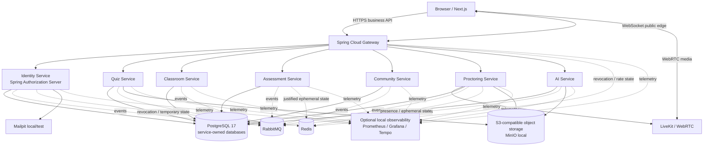

# System Architecture

Status: **Accepted pre-scaffold baseline v0.2**

## Architectural style

Quizopia 2.0 uses **coarse-grained microservices** in a true monorepo.

The purpose is clear ownership and independently scalable workloads, not maximizing service count.

## Logical topology

This is a logical architecture. Deployment topology may evolve without violating service ownership.

## Public edge

Spring Cloud Gateway is the public business/API edge.

Browser business HTTP calls do not target backend microservices directly.

Public WebSocket endpoints are routed through the edge topology.

WebRTC media is intentionally separate and connects to LiveKit.

## Business services

- Identity Service
- Quiz Service
- Classroom Service
- Assessment Service
- Community Service
- Proctoring Service
- AI Service

No standalone Grading Service is part of the baseline; grading stays with Assessment to preserve transactional correctness.

## Authentication topology

Identity Service acts as Quizopia's authorization server.

It issues Quizopia credentials/tokens after local or Google-based authentication.

Gateway and each protected service validate user JWTs independently using Quizopia public signing material/JWKS.

Internal synchronous service calls use OAuth2 Client Credentials service JWTs.

## Communication

### Authoritative business operations

Use transactional HTTP/REST APIs.

Examples:

- start/autosave/submit attempt;
- create/update quiz;
- classroom membership commands;
- result retrieval.

### Synchronous internal service communication

Use direct internal REST when the caller needs an immediate answer.

Do not route service-to-service traffic through the public gateway.

### Integration events

Use RabbitMQ for asynchronous business facts.

Critical events require transactional outbox publication and idempotent consumers.

### Application realtime

Use WebSocket for UI acceleration/realtime signals.

The database/read API remains authoritative and clients reconcile after reconnect.

### Realtime media

Use WebRTC/LiveKit for camera, optional microphone, and future screen sharing.

## Data ownership

Every service owns its database and credential.

Databases may share one physical PostgreSQL server/cluster in local or early deployment, but services must not access another service's data store.

## Critical assessment invariant

An active assessment must keep working when Quiz Service is unavailable.

Assessment therefore stores a self-contained immutable delivery snapshot before the active-attempt path depends on it.

For Wave 3, the snapshot is finalized atomically with Publication `DRAFT → OPEN`.
All Attempts in that Publication use the finalized snapshot, including its pinned
grading policy. The accepted details and remaining API/data contract gates are in
[Assessment Core policy](../specifications/assessment-core-policy.md).

The subsequent [W3-A Leader decision](../specifications/w3-a-publication-scheduling-monitoring-policy.md)
adds CLASS/PUBLIC, bounded participation scheduling and positive Attempt duration
to Wave 3. Classroom owns authoritative Teacher/member eligibility; Proctoring
owns Activity Evidence and LiveKit session/token orchestration for optional
eligible CLASS monitoring. These are required Wave 3 outcomes with separate
service boundaries. AI behavior analysis remains accepted future design, deferred
after Wave 3; no monitoring outage may corrupt answers/results or extend deadlines.

## Local development

Default workflow is hybrid:

- Docker runs infrastructure;
- developer runs the active backend service/gateway in the IDE;
- developer runs Next.js with its normal dev server;
- a full-container profile may exist for integration/demo use.

## W3-B/C policy and proposed engineering extension

The later [ADR-015](../decisions/ADR-015-w3b-w3c-leader-policy.md) accepts unlimited
individual duration 0 (bounded start windows remain), configurable maxAttempts,
explicit retake/ABANDON, strict numeric input and two-step delayed Teacher closure.
[The integrated engineering pack](../architecture/w3b-w3c-contract-review-evidence.md)
proposes Assessment-owned closure notices in a real authenticated inbox, atomic
local grading/results and existing service authority boundaries. This scoped
notice projection transfers no Classroom/Identity authority and adds no service.
W3-A PR #78 is implemented. ADR-015 records W3-B/C engineering direction
APPROVED WITH CONDITIONS (EC79-01..04); routes/schema remain PROPOSED/UNIMPLEMENTED.
Independent amendment/security/runtime review remains; production is not authorized.
Monitoring stays bounded CLASS-only; unlimited CLASS and PUBLIC cannot ENABLE.
Practice/general inbox/gradebook events and operational/privacy release gates remain.
