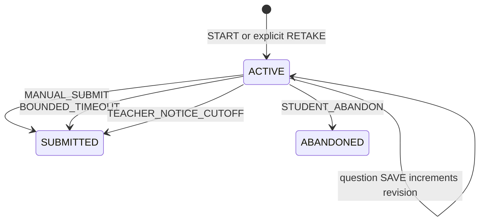

# W3-B — Attempt lifecycle contract

Status: **PROPOSED engineering contract; Leader product policy accepted in ADR-015.**

[ADR-015](../decisions/ADR-015-w3b-w3c-leader-policy.md) is the current policy.
W3-A already implements Publication preparation/opening/entry and bounded schedule
extension, not Attempts. All routes here are future proposals in the
[HTTP contract](w3b-w3c-http-contract.md) and
[OpenAPI 3.1 artifact](proposed/w3b-w3c.openapi.yaml).
[Persistence/locks](../architecture/w3b-w3c-persistence-concurrency-design.md)
are normative proposed implementation requirements. Practice/guest/shuffle and
monitoring runtime are deferred. External gates: independent review, Leader
sign-off, LD-05 provisioning/topology, capacity, time and durable failover controls.

## Configuration and identity

Future DRAFT configuration adds integer `maxAttempts` (0..10, omitted defaults 1)
and admits integer duration 0 or 5..240. PUBLIC monitoring DISABLED; duration 0
CLASS must explicitly select DISABLED before OPEN (UNCONFIGURED may remain in
DRAFT). Existing OPEN configuration JSON stays byte-semantically unchanged; a
relational default and compatibility projection supply maxAttempts 1. No legacy
snapshot is rewritten. OPEN freezes entitlement. OPEN schedule extension keeps
startAt fixed, endAt nondecreasing, positive duration nondecreasing for future
Attempts, unlimited duration fixed at 0. Pending closure forbids schedule changes.
Extensions never recalculate a pinned deadline or reopen CLOSED. Existing W3-A
OpenAPI remains the implemented baseline until a reviewed implementation updates it.

An Attempt has random UUID, Publication/snapshot identity, Student UUID from USER
subject, positive ordinal, pinned gradingPolicyVersion 1 and pinned duration.
No synthetic question/option UUID: use snapshot-local continuous question `number`
and option/statement labels A-D. Preserve source question and A-D order in every
resume. Each new retake uses the same immutable snapshot, separate answer/result
identity and ordinal; it never overwrites a terminal Attempt.

Proposed states are `ACTIVE`, `SUBMITTED`, `ABANDONED`:

SUBMITTED means grade/result/final answers already committed atomically; there is
no fake GRADED/pending result state. ABANDONED is terminal without a result.
Every state-changing operation increments Attempt revision once; initial revision 0. Timeout/closure increment once, with no per-answer revision increments inside
finalization. Terminal identity, answers, revision and result cannot change.

## Security and eligibility

Every Student HTTP operation and replay requires USER + STUDENT in issued token
and fresh current Identity admission independently at Gateway and Assessment.
CLASS operations on Attempt/delivery/result/aggregate/review additionally confirm
current evidence-derived membership through W3-A's private Classroom handoff;
removal masks as 404, outage as sanitized 503. No stale membership positive cache.
PUBLIC new START/RETAKE requires the existing 43-character locator in the body,
resolved to the path Publication; a known UUID alone cannot create work. Once
owned, Attempt read/mutation/result and aggregate need ownership, not locator
re-disclosure. Link access never grants another Student's Attempt.

Teacher actions require USER + issued/current TEACHER and persisted Publication
owner. ADMIN or SERVICE alone never satisfies either user route. No new product
rule is introduced for owner self-participation. Private calls use existing
least-privilege scopes, not Gateway forwarding of service credentials.
Remote admission/membership occurs before the bounded local transaction. Inside
the lock, recheck actor/resource binding, state and USER token expiry; an expired
token gets 401. Authority has the existing bounded in-flight snapshot limitation,
not distributed atomicity with role/membership changes.

## START, RESUME and RETAKE

START uses an Idempotency-Key and fresh authority. Under Publication lock, check
successful replay first, then inspect this Student's persisted Attempts:

1. Reconcile an overdue ACTIVE bounded Attempt, or a cutoff-eligible ACTIVE
   unlimited Attempt from a live closure request, using committed answers.
2. If ACTIVE remains, return it for resume; no new entitlement consumed.
3. If any terminal Attempt exists, return highest ordinal, even if entitlement
   remains. START never silently retakes.
4. Only when none exists may START create ordinal 1. Require OPEN, no pending
   closure, valid audience/locator and `startAt <= serverNow < endAt`.

Reading/resuming existing work does not require a still-open participation
window. Existing terminal START replay/read also remains possible after CLOSED
under owner/current authority. A START receipt stores the selected Attempt ID;
replay returns that same identity's current safe view (not a different latest
retake). Initial creation responds 201; existing selection and replay respond 200.

GET Attempt resumes via safe projection. It reconciles due terminalization first;
this is documented Attempt reconciliation, never a hidden Publication transition.
Reconciliation does not depend on Quiz, Classroom or Identity for a system-grade
write; the caller must still pass authorization to obtain data.

RETAKE is separate: at least one prior terminal Attempt, no ACTIVE, OPEN/no pending
closure, current eligibility, valid start window and finite count below maxAttempts
(or 0 unlimited). If ACTIVE exists with another key, 409 ACTIVE_ATTEMPT_EXISTS;
if no previous terminal Attempt, 409 RETAKE_NOT_AVAILABLE. Matching key replays
its original Attempt ID even after completion. A new distinct key can consume
another entitlement only after the latest Attempt is terminal. Count every
created Attempt, including ABANDONED, under the Publication lock. Failed or
rolled-back creation consumes nothing. Unique `(publication_id, student_id,
ordinal)` and partial ACTIVE uniqueness backstop the transaction; Redis is never
the entitlement authority. Gaps are not introduced by using database sequences.

## Server time and deadline

Use timezone-safe PostgreSQL microsecond instants; responses UTC with Z. Sample
`clock_timestamp()` **after acquiring all operation locks and immediately before
eligibility/answer writes**. Do not use transaction-start NOW, request-arrival
time or a clock captured before waiting for the lock. Store that sampled instant
as startedAt for creation. Positive pinned duration yields deadline = startedAt +
duration minutes. Duration 0 yields SQL/JSON null, never infinity/far future.

New creation checks the window. Existing ACTIVE mutations ignore endAt; they
require strictly before the bounded deadline, or before the individual confirmed
closure cutoff for an unlimited Attempt. A pending request with missing notice
has no effective cutoff and cannot force-finalize that Attempt. Effective cutoff
is ignored for CANCELLED/COMPLETED/RESOLVED_EARLY requests. There is no grace.
A request validated before cutoff may commit just after it: eligibility linearizes
at the locked time sample; the finalizer waits and uses the committed state.

At/after bounded deadline, reconcile BOUNDED_TIMEOUT exactly once from saved
answers before reporting 409 ATTEMPT_DEADLINE_REACHED for a new mutation. At/after
confirmed live closure cutoff, reconcile TEACHER_NOTICE_CUTOFF and return 409
CLOSURE_CUTOFF_REACHED. Use an outcome that commits reconciliation before mapping
409; throwing an exception that rolls it back is forbidden. Malformed requests
are rejected before any business mutation/reconciliation (400 without mutation).
If grading/persistence fails, roll back completely and return 503; the deadline
still prohibits mutation on the next request, despite delayed processing.

## SAVE and durable replay

POST one question: typed answer + expectedRevision, operation identity in required
Idempotency-Key. Attempt ID is the path; questionNumber is the path and is checked
against the pinned snapshot. Answer type must match the question. Validate all
input before a mutation. See [grading validation](w3-c-grading-results-contract.md).
No client score, actor, timestamp, ordinal, deadline or grading field is accepted.

Replay scope `(attemptId, operation-key-digest)` spans SAVE/SUBMIT/ABANDON. Digest
includes action, normalized route/question, expectedRevision and canonical typed
payload. Same key with different action/question/revision/answer is 409
IDEMPOTENCY_CONFLICT. For accepted numeric spelling, outer ASCII whitespace is
trimmed; preserve the four-character token thereafter. Sort MULTIPLE_CHOICE sets
for digest only after rejecting duplicates; sort matrix object keys. No numeric
value normalization (`0001` differs from `1.00`). Reject duplicate JSON keys,
trailing document, unknown fields, nonintegral revisions and unknown labels.
Failed stale/eligibility mutations do not allocate a successful receipt; a client
may retry the same key/payload after re-reading, but any changed payload uses a
new key. Persisted successful acknowledgments remain immutable.

After authority/ownership and input validation, check durable successful receipt
before terminal/revision/deadline checks. Identical receipt returns the original
acknowledgment even if Attempt later terminal; this is no new mutation. New key
requires ACTIVE, pre-cutoff and expectedRevision equality. Upsert one answer,
increment Attempt-wide revision once, persist immutable `{attemptId,
questionNumber, revision, savedAt}` acknowledgment in the same transaction.
Same key/payload concurrent calls converge; independent same-revision calls give
one success and one 409 REVISION_CONFLICT, even for different questions.
Clients re-read and explicitly reconcile their edits; no automatic last-write-wins.

No-op or repeated answers under a new key still count as a new revision mutation.
Unanswered is typed null/empty as specified; saving unanswered clears that question.
A terminal Attempt rejects new mutations with 409 ATTEMPT_TERMINAL.

## Manual SUBMIT, ABANDON and automatic finalization

SUBMIT requires Idempotency-Key and expectedRevision. Optional `answers` is a
**complete** set: exactly one entry per snapshot question, explicit unanswered
values, no duplicates/missing/extra questions. Omission means freeze all latest
saved answers, filling never-saved questions as unanswered. An included complete
set replaces saved state atomically. Reject malformed nonblank numeric answers
or malformed references with 400 without changes. Recheck revision and eligibility
under locks; commit answers, immutable submitted-answer ID/digest, v1 exact result,
terminal state/reason, revision, timestamp and replay receipt together. No external
grader/dependency/distributed transaction. Matching completed submission retry
returns the same stored result ID/totals without regrading, including when the
Publication later closes; changed key/payload is 409, never another grade.

ABANDON requires key and expectedRevision; authorized owner, ACTIVE and strictly
pre-cutoff. Commit terminal STUDENT_ABANDON and acknowledgment together, increment
revision once, preserve committed answers as restricted historical data, create
no submitted-answer/result. Matching receipt returns original acknowledgment.
Different key on terminal returns ATTEMPT_TERMINAL. It consumes entitlement and
cannot be undone. Browser lifecycle events cannot call implicit ABANDON.

Timeout and closure use one shared deterministic finalizer and latest committed
answers only; browser-only changes are excluded. A persisted result is unique per
Attempt and immutable. Workers scan indexed due rows but lock Publication before
Attempt and recheck time/state/workflow. System finalization does not impersonate
Student or require an expired/removed Student's live credentials. Caller-facing
operations still require current authority. Workers never close Publication.
See [closure](w3-b-closure-notification-contract.md) for distinct audit and cancellation.
